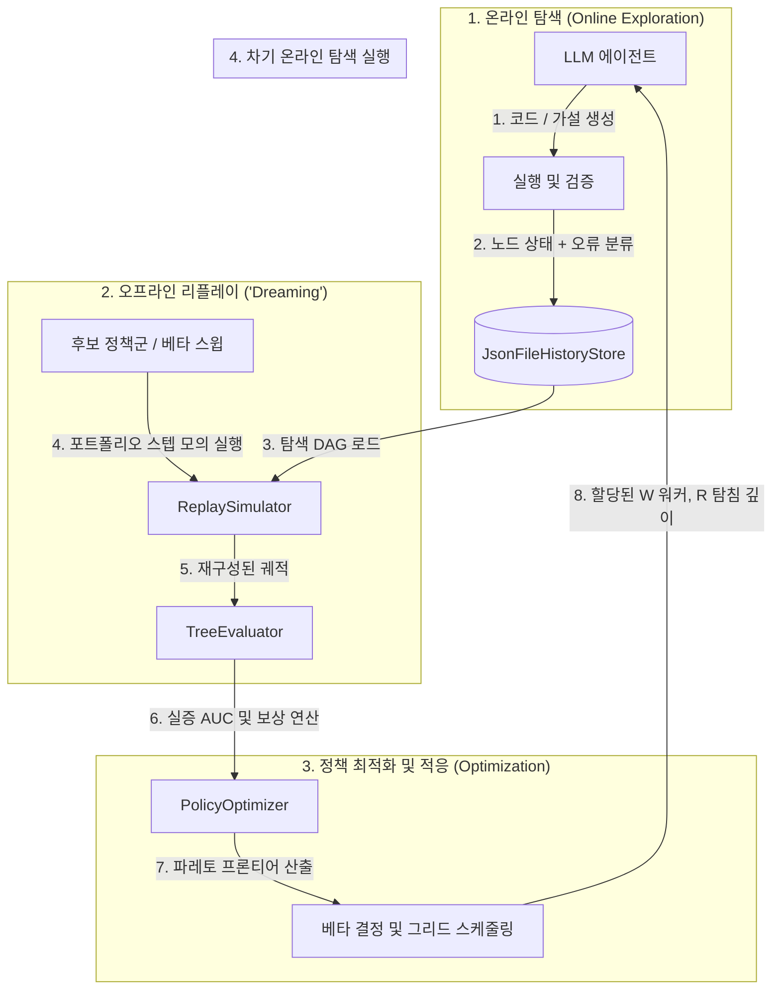
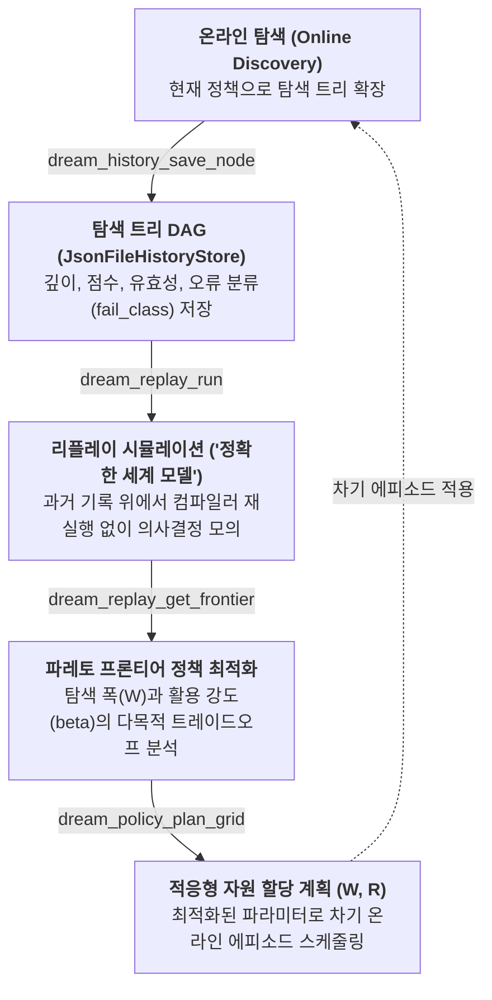

<div align="center">

<p>
  
  &nbsp;&nbsp;&nbsp;&nbsp;&nbsp;&nbsp;
  <picture>
    <source media="(prefers-color-scheme: dark)" srcset="../../assets/logos/google-deepmind-dark.svg">
    
  </picture>
  &nbsp;&nbsp;&nbsp;&nbsp;&nbsp;&nbsp;
  <picture>
    <source media="(prefers-color-scheme: dark)" srcset="../../assets/logos/umd-dark.svg">
    
  </picture>
  &nbsp;&nbsp;&nbsp;&nbsp;&nbsp;&nbsp;
  <picture>
    <source media="(prefers-color-scheme: dark)" srcset="../../assets/logos/uva-dark.svg">
    
  </picture>
</p>

[English](../../README.md) · **한국어** · [日本語](README_jp.md) · [中文](README_cn.md)

# DREAM-RSI: 재귀적 자기 개선 엔진

### AI 에이전트를 위한 탐색 트리 기반 자율 개선 및 검색 정책 최적화 프레임워크

**탐색 시도를 기록하고, 오프라인으로 궤적을 리플레이하며, 검색 정책 할당을 최적화합니다.**

[](https://github.com/Hyelcyon/DREAM-RSI/releases)
[](https://github.com/Hyelcyon/DREAM-RSI/actions/workflows/ci.yml)
[](https://python.org)
[](../mcp-contracts.md)
[](../../LICENSE)
[](https://arxiv.org/abs/2609.14858)

[빠른 시작](#빠른-시작) · [작동 원리](#작동-원리) · [MCP 도구 목록](#mcp-도구-목록) · [수학적 정식화](#수학적-정식화) · [아키텍처 및 안전성](#아키텍처-및-안전-불변식) · [개발 및 검증](#개발-및-검증) · [FAQ](#faq) · [인용](#인용)

<code>uv run dream-rsi</code>

<br />

</div>

---

**DREAM-RSI**는 연구 논문 *Dreaming While Exploring: Recursive Self-Improvement in LLM-Based Discovery Systems* (arXiv: 2609.14858)를 기반으로 구현된 Python 검색 정책 최적화 엔진이며, Model Context Protocol (MCP) STDIO 서버로 동작합니다.

자율 AI 에이전트가 알고리즘 합성, 수학적 최적화, 시스템 코드 작성을 수행할 때 대규모 시행착오 트리가 형성됩니다. 매번 온라인 환경에서 새로운 탐색 정책을 평가하는 것은 큰 비용과 실행 지연을 초래합니다. DREAM-RSI는 **온라인 트리 확장**과 **오프라인 정책 평가**를 분리합니다:

1. **가상 시뮬레이터로서의 탐색 트리**: 과거 실행 기록은 노드별 실행 결과 및 검증 신호를 포함하는 방향성 비순환 그래프(DAG)를 구성합니다. 리플레이 엔진은 외부 LLM 호출 없이 이 그래프를 시뮬레이션 환경으로 사용합니다.
2. **오프라인 리플레이('Dreaming')**: 과거 상태-행동 전이 위에서 다양한 탐색-활용 균형 계수($\beta$)를 적용하여 여러 정책 후보군을 시뮬레이션합니다.
3. **다목적 프론티어 평가**: 파레토 효율성 지표를 기반으로 탐색 폭($W$)과 반복 정제 깊이($R$) 간의 실증적 트레이드오프를 도출합니다.
4. **재귀적 탐색 전략 개선**: 오프라인 리플레이로 검증된 최적 정책을 다음 온라인 탐색 에피소드에 적용하여, 향후 정책 개선을 위한 더 풍부한 탐색 트리를 누적합니다.

---

## 빠른 시작

### 1. 에이전트 설정

DREAM-RSI를 표준 STDIO MCP 구성을 통해 에이전트 환경에 연동합니다.

#### Claude Code (`claude_desktop_config.json` 또는 프로젝트 설정)

```json
{
  "mcpServers": {
    "dream-rsi": {
      "command": "uv",
      "args": ["run", "--directory", "/absolute/path/to/DREAM-RSI", "dream-rsi"],
      "env": {
        "DREAM_RSI_STORE_DIR": "/absolute/path/to/DREAM-RSI/data/trees"
      }
    }
  }
}
```

#### Google Antigravity / Gemini CLI (`mcp_config.json`)

```json
{
  "mcpServers": {
    "dream-rsi": {
      "command": "uv",
      "args": ["run", "--directory", "/absolute/path/to/DREAM-RSI", "dream-rsi"]
    }
  }
}
```

#### Cursor (`.cursor/mcp.json`)

```json
{
  "mcpServers": {
    "dream-rsi": {
      "command": "uv",
      "args": ["run", "--directory", "/absolute/path/to/DREAM-RSI", "dream-rsi"]
    }
  }
}
```

#### OpenAI Codex (`config.toml`)

```toml
[mcp_servers.dream-rsi]
command = "uv"
args = ["run", "--directory", "/absolute/path/to/DREAM-RSI", "dream-rsi"]
```

### 2. 에이전트 질의 예시

탐색 작업 진행 중 또는 완료 후 에이전트에게 다음과 같이 요청합니다:

```text
현재 탐색 트리를 dream_history_save_node로 기록하고, 베타 값에 따른 오프라인 리플레이를 실행한 뒤 파레토 프론티어를 분석하여 다음 탐색의 워커 그리드(W, R)를 계획해줘.
```

### 3. 터미널 단독 실행

`uv`를 통해 MCP 서버를 직접 실행할 수 있습니다:

```bash
uv run dream-rsi
```

모든 진단 로그는 표준 에러(stderr)로 출력되어 STDIO를 통한 JSON-RPC 전송의 무결성을 보장합니다.

---

## 작동 원리



### 재귀적 자기 개선 루프 (Recursive Self-Improvement Loop)

DREAM-RSI는 기본 LLM의 가중치 수정이나 정책 최적화 단계에서의 추가 외부 LLM 호출 없이, 탐색 전략 자체를 최적화합니다:



### 모듈 구조 및 실행 단계

1. **탐색 트리 저장소 (`src/dream_rsi/storage/`, `src/dream_rsi/core/models.py`)**
   - 기록되는 노드는 `node_id`, `parent_id`, `branch_id`, `attempt_index`를 유지합니다.
   - 각 노드는 실행 결과인 `Observation` 객체를 포함하며 상태를 분류합니다 (`syntax_error`, `runtime_error`, `shape_mismatch`, `ok` 등).
   - `JsonFileHistoryStore`는 순환이 없는 DAG 위상 구조를 검증하고 디스크 원자적 저장을 보장합니다.

2. **리플레이 시뮬레이션 (`src/dream_rsi/replay/`)**
   - `QuestionAPI`는 과거 탐색 트리를 자원 예산과 병렬 제한이 있는 상태형 문제 환경으로 추상화합니다.
   - `ReplaySimulator`는 실제 컴파일러나 인터프리터를 재실행하지 않고, 검증된 노드 궤적을 순회하며 다양한 정책을 평가합니다.

3. **정책 평가 및 신호 감지 (`src/dream_rsi/core/signals.py`, `src/dream_rsi/core/evaluator.py`)**
   - 궤적 신호는 브랜치를 완전 실패, 정체, 또는 유망한 앵커 노드로 분류합니다.
   - `TreeEvaluator`는 도달한 최고 점수, 순차적 의사결정 라운드 수, 병렬화 패널티를 고려하여 에피소드를 평가합니다.

4. **정책 최적화 (`src/dream_rsi/optimizer/`)**
   - `DynamicPortfolioPolicy`는 활용 계수 $\beta \in [0, 1]$를 조절하여 신규 루트 탐색과 기존 고득점 브랜치 정제 간의 워커 할당을 배분합니다.
   - `PolicyOptimizer`는 $\beta$ 스윕을 통해 파레토 프론티어를 도출하고, 다음 탐색 에피소드를 위한 워커 수($W$)와 탐침 깊이($R$)를 계획합니다.

---

## MCP 도구 목록

DREAM-RSI는 11개의 MCP 도구와 3개의 리소스를 제공합니다:

| 도구명 | 목적 | 주요 파라미터 | 반환값 |
| :--- | :--- | :--- | :--- |
| `dream_history_list` | 등록된 모든 탐색 트리 및 세션 목록 조회 | 없음 | 트리 ID 및 총 개수를 포함하는 JSON 객체 |
| `dream_history_get_tree` | 특정 트리의 전체 노드 위상 및 메타데이터 조회 | `tree_id` | 전체 트리 토폴로지 및 노드 기록 |
| `dream_history_save_node` | 탐색 시도 노드 저장 | `tree_id`, `node_data` | 노드 저장 확인 및 갱신된 노드 수 |
| `dream_replay_run` | 트리에 대해 정책 오프라인 가상 리플레이 실행 | `tree_id`, `beta`, `worker_cap`, `max_budget` | 리플레이 에피소드 지표 및 최고 점수 |
| `dream_replay_get_frontier` | 전체 트리 대상 베타 스윕 파레토 프론티어 연산 | `beta_steps`, `worker_cap`, `max_budget` | 파레토 프론티어 좌표 배열 |
| `dream_policy_compare` | 후보 정책과 베이스라인 정책의 승률 및 점수 비교 | `candidate_beta`, `baseline_beta`, `worker_cap` | 승률, 점수 델타, 정책 추천 결과 |
| `dream_policy_plan_grid` | 결정론적 워커 수 $W$ 및 깊이 $R$ 그리드 계획 | `context` (선택 사항) | 권장 $W$ 및 $R$ 그리드 파라미터 |
| `dream_policy_select_beta` | 교차 주기 기본 베타 적응 연산 | `history_scores`, `current_beta`, `worker_cap` | 다음 주기 베타, 변화량 및 사유 |
| `dream_benchmark_evaluate` | 과학적 벤치마크 문제에 대한 후보 해법 검증 | `problem`, `payload` | 유효성 여부, 세부 메트릭 및 최종 점수 |
| `dream_benchmark_create_tree` | 벤치마크 기반 가상 탐색 트리 인스턴스화 | `problem`, `tree_id`, `num_branches`, `depth_per_branch` | 트리 ID, 문제 유형 및 총 노드 수 |
| `dream_status` | 엔진 상태 및 스토리지 무결성 진단 | 없음 | 헬스 상태 및 저장소 경로 메타데이터 |

### MCP 리소스

- `dream://history/manifest`: 기록된 모든 탐색 트리의 요약 매니페스트를 반환합니다.
- `dream://status`: 엔진 헬스 진단 및 스토리지 무결성 결과를 반환합니다.
- `dream://benchmarks/catalog`: 과학적 탐색 벤치마크 과제 카탈로그 및 검증 기준을 반환합니다.

---

## 수학적 정식화

### 탐색과 활용의 밸런스 ($\beta$)

동적 포트폴리오 정책은 후보 품질 점수와 활용 계수 $\beta \in [0, 1]$에 따라 행동을 샘플링합니다:

$$P(\text{refine} \mid \text{node}_i) \propto \exp\left(\frac{\beta \cdot \text{score}_i}{\tau}\right)$$

- $\beta \to 0$: 미검증 분기에 대한 다양한 탐색에 가중치를 부여합니다.
- $\beta \to 1$: 높은 점수의 후보 노드를 깊게 정제하는 데 연산을 집중합니다.

### 검색 그리드 최적화 $(W, R)$

총 워커 예산 $B$가 주어졌을 때, 분기 폭 $W$와 정제 깊이 $R$의 최적 배분을 산출합니다:

$$W \cdot R \le B, \quad \max_{W, R} \mathbb{E}\left[\max_{i \le W} S_i^{(R)}\right]$$

---

## 아키텍처 및 안전 불변식

- **오프라인 경계**: 외부 네트워크 요청이나 텔레메트리가 전혀 없으며, 저장소 작업은 지정된 디렉터리(`DREAM_RSI_STORE_DIR`) 내부로 엄격히 제한됩니다.
- **경로 탐색 방지**: 상위 경로 탐색 시도(`../`)는 자동으로 탐지되어 차단됩니다.
- **원자적 영속성**: 탐색 트리 수정은 임시 파일 작성 후 원자적 교체 방식을 사용하여 비정상 종료 시에도 파일 손상을 방지합니다.
- **엄격한 타입 안전성**: Pyright strict 모드를 적용하여 `Any` 우회 없이 정적 분석을 통과합니다.

---

## 개발 및 검증

DREAM-RSI는 `uv` 및 Python 3.10 이상을 사용합니다.

### 의존성 설치

```bash
uv sync
```

### 정적 타입 분석

```bash
uv run pyright
```

### 테스트 스위트 실행

```bash
uv run pytest
```

### 실시간 STDIO MCP 프로토콜 검증

```bash
uv run python scripts/verify_mcp.py
```

---

## FAQ

<details>
<summary><strong>어떤 에이전트에서 사용할 수 있나요?</strong></summary>

STDIO 기반 MCP를 지원하는 모든 에이전트(Claude Code, Google Antigravity, Cursor, OpenAI Codex 등)에서 사용할 수 있습니다.
</details>

<details>
<summary><strong>오프라인 리플레이 시 외부 LLM 호출이 필요한가요?</strong></summary>

아닙니다. 온라인 세션에서 기록된 실행 그래프와 결정론적 검증 오라클을 사용하므로, 외부 네트워크 요청이나 LLM 프롬프트 없이 순수 연산으로 정책을 평가합니다.
</details>

<details>
<summary><strong>탐색 트리는 어떻게 저장되나요?</strong></summary>

`DREAM_RSI_STORE_DIR` 또는 `data/trees/` 경로에 방향성 비순환 그래프(DAG) 형태의 로컬 JSON 파일로 원자적으로 안전하게 저장됩니다.
</details>

<details>
<summary><strong>W와 R은 무엇을 의미하나요?</strong></summary>

$W$는 병렬 탐색 워커 수(가설 분기 폭), $R$은 분기당 정제 깊이(반복 예산)를 의미합니다. 그리드 플래너는 총 예산 $B$ 내에서 최적의 균형점을 계산합니다.
</details>

---

## 인용

연구 또는 에이전트 워크플로에서 DREAM-RSI를 활용하시는 경우 다음 연구 논문을 인용해 주십시오:

```bibtex
@article{zheng2026dreamrsi,
  title={Dreaming While Exploring: Recursive Self-Improvement in LLM-Based Discovery Systems},
  author={Zheng, Kid and collaborators},
  journal={arXiv preprint arXiv:2609.14858},
  year={2026}
}
```

---

## 라이선스

본 프로젝트는 MIT 라이선스에 따라 배포됩니다. 자세한 내용은 [LICENSE](../../LICENSE) 및 [NOTICE](../../NOTICE)를 참고하십시오.
